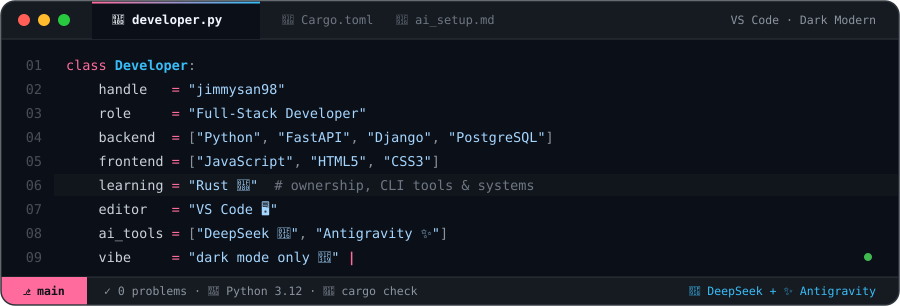

 

## 👨‍💻 About Me & Workspace

  

 

## 🛠️ Tech Arsenal & AI Workflow

<table>
  <tr>
    <td width="52%" valign="top" align="center">
      <h3>⚙️ Core Stack &amp; Tools</h3>
       
      
        
      
      
      
      
       
      
      
      
      
    </td>
    <td width="48%" valign="top" align="center">
      <h3>🤖 Daily Drivers &amp; Focus</h3>
       
      
      
      
        
      

        <ul>
          <li>🐍 <b>Backend &amp; APIs:</b> Building reliable services and automation in <b>Python</b></li>
          <li>⚡ <b>Frontend:</b> Crafting interactive web interfaces with <b>JavaScript</b>, HTML &amp; CSS</li>
          <li>🦀 <b>Learning Rust:</b> Exploring memory safety, ownership &amp; fast CLI tools</li>
          <li>🤖 <b>AI Workflow:</b> Shipping faster inside <b>VS Code</b> using <b>DeepSeek</b> &amp; <b>Antigravity</b></li>
        </ul>
      

    </td>
  </tr>
</table>

 

  

 

## 📊 GitHub Analytics

  

  

 

 

